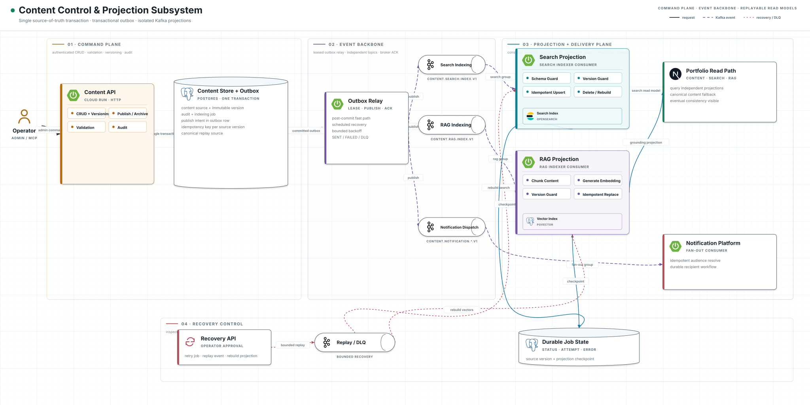

# portfolio-admin-service

Admin content platform behind [yuqi.site](https://www.yuqi.site). Owns the
**write side** of the portfolio (Blogs, Projects, life_blogs, experience),
plus the workers that fan published content out to **OpenSearch** (full-text
search) and **pgvector** (RAG embeddings via OpenAI).

This is a multi-module Maven repo containing three independently-deployed
Spring Boot services that share a Supabase Postgres database and communicate
only over Kafka — no inter-service HTTP.

---

## System Design

The component view separates the transactional content command plane from the
Kafka event backbone, independently replayable search/RAG projections,
notification delivery, and operator-approved recovery control.



> **Maintain this diagram:** edit [`docs/architecture/content-platform.json`](docs/architecture/content-platform.json), then run `node scripts/render-architecture-diagram.mjs docs/architecture/content-platform.json`.

**Design properties:**

1. **Transactional outbox.** `admin-service` never publishes to Kafka inside a
   DB transaction. Each publish writes `content_versions` +
   `content_event_outbox` + `indexing_jobs` atomically, then a post-commit
   hook fires Kafka asynchronously. If Kafka is down the rows stay
   `PENDING` and a re-publisher (TODO) drains them.
2. **One consumer group per worker.** `search-indexer-group` and
   `rag-indexer-group` consume independently — a slow OpenAI call in the
   RAG worker cannot delay search indexing.
3. **At-least-once + idempotency key.** Each event carries
   `idempotencyKey = "{jobType}:{sourceType}:{sourceId}:v{version}"`.
   Both workers upsert by key, so replay is safe.
4. **Hibernate `ddl-auto: none`.** This service does NOT own the existing
   Supabase tables (`"Blogs"`, `"Projects"`, …). It owns only its own
   admin-platform tables, managed by Flyway. Schema validation is off so
   sharing the database with the Next.js portfolio app is safe.

## Production Operating Model

This repository owns the portfolio **content write plane**. The write API is
deliberately separated from read projections so publishing content does not
couple editor latency to OpenSearch, embedding generation, or email delivery.

Senior/staff-level invariants:

| Invariant | Implementation expectation |
|---|---|
| Source of truth first | A content mutation commits the source table, immutable version snapshot, audit row, indexing jobs, and outbox rows in one database transaction |
| Async projections | Search, RAG, and notification updates are Kafka-driven projections, never synchronous side effects of the editor request |
| Replay-safe recovery | Failed or stuck outbox/indexing jobs can be retried by job id or content id; consumers upsert by deterministic idempotency key |
| Schema ownership | Admin-service migrates only admin-owned tables; shared Portfolio tables are read/write adapted without Hibernate DDL changes |
| Admin accountability | Every create/update/publish/retry action records actor, action, source, version, and request metadata |
| Least privilege | Browser calls use Supabase JWT + allow-listed email; server-to-server jobs use `X-Admin-Secret` only when a JWT is not available |

Operationally, Kafka can be cold or temporarily unavailable without losing the
publish intent: the database outbox remains the recovery source and can be
republished when the broker or indexers recover.

---

## Repository layout

| Module                         | Port | Container image (Artifact Registry)                                                |
|--------------------------------|------|------------------------------------------------------------------------------------|
| `admin-service/`               | 8081 | `us-central1-docker.pkg.dev/portfolio-notify-prod/portfolio/portfolio-admin-service` |
| `search-indexer/`              | 8082 | `…/portfolio-search-indexer`                                                       |
| `rag-indexer/`                 | 8083 | `…/portfolio-rag-indexer`                                                          |
| `media-service/`               | 8084 | not deployed yet: image builds in CI, no deploy workflow                           |

All three services are built from this monorepo by their own GitHub Actions
workflow under `.github/workflows/deploy-*.yml`. Each builds only its
module via `mvn -pl <module> -am package` and pushes its own image.

```
.
├── admin-service/             Write API + outbox + Flyway migrations
│   ├── src/main/java/site/yuqi/admin/
│   │   ├── controller/        REST endpoints (/api/admin/**)
│   │   ├── service/           ContentService, OutboxService, IndexingJobService, AuditLogService
│   │   ├── domain/            JPA entities (admin-owned tables)
│   │   ├── domain/source/     Read adapters for shared tables (Blog, Project, LifeBlog, Experience)
│   │   ├── events/            ContentIndexEvent, ContentPublishedEvent + publishers
│   │   ├── security/          AdminAuthFilter (X-Admin-Secret + Supabase JWT)
│   │   └── adapter/           NormalizedContent + per-source normalizers
│   └── src/main/resources/db/migration/V1__admin_content_platform.sql
├── search-indexer/            Kafka → OpenSearch upserts
│   └── src/main/java/site/yuqi/searchindexer/
│       ├── kafka/             @KafkaListener for content.search.index.v1
│       ├── config/            KafkaConsumerConfig (ErrorHandlingDeserializer)
│       └── opensearch/        Aiven OpenSearch REST client
├── rag-indexer/               Kafka → OpenAI embeddings → pgvector
│   └── src/main/java/site/yuqi/ragindexer/
│       ├── kafka/             @KafkaListener for content.rag.index.v1
│       ├── chunk/             Sliding-window chunker (2000 chars / 200 overlap)
│       └── embed/             OpenAI embeddings client + kb_documents writer
└── .github/workflows/
    ├── deploy-admin-service.yml
    ├── deploy-search-indexer.yml
    └── deploy-rag-indexer.yml
```

---

## Media pipeline (images and video)

Upload an original once; visitors get adaptive video (HLS at 360p, 720p and 1080p) and images in
AVIF and WebP at six widths. It follows the classic upload → queue → transcode → publish design.
The admin upload API is off until `MEDIA_PIPELINE_ENABLED=true`. This is not a global worker
kill switch: the separate Media Service defaults its Kafka consumer and worker to enabled.
Do not start that service against production before completing the deployment checks below.

Two services take part. The upload API is part of `admin-service`. `media-service` is the one
new service: it hears that an upload is complete, plans the work, runs FFmpeg and libvips, checks
the result and publishes it. They share nothing but the database tables below, one Kafka topic and
one wake-up call.

| Step | What happens | Where |
|------|--------------|-------|
| 1 | Browser asks to upload; gets one signed URL per part | `POST /api/admin/media/uploads` · `MediaUploadService.start` |
| 2 | Browser PUTs the parts straight to the originals bucket, then confirms | `POST /api/admin/media/{id}/upload-complete` |
| 3 | Source bound, status `PROCESSING` and one outbox row, in one transaction; a relay delivers the row to Kafka | `MediaAssetStore.bindSource` · `MediaOutboxRelay` |
| 4 | Media Service records a `PLAN` job, then acknowledges the offset; the plan probes the file and creates one job per output | `WorkIntake` · `PlanHandler` |
| 5 | Workers lease jobs, renew the lease while FFmpeg runs | `JobRunner` · `MediaRepository.claimNext` |
| 6 | Segments and playlists go under the attempt's own prefix | `VideoRenditionHandler` · `Outputs` |
| 7 | Every reported file is checked in the bucket, the master playlist is written, then one UPDATE flips the asset to `READY` | `PublishHandler` · `MediaRepository.publish` |

**No new Kafka topic.** The event is published on `content.search.index.v1` with
`jobType=MEDIA_PROCESS`, `sourceType=MEDIA` and no `indexingJobId`. It uses the same envelope as
`ContentIndexEvent` plus `sourceKey` and `profileVersion`. `media-service` reads the topic with its
own consumer group (`media-service-group`) and ignores everything else; `search-indexer` skips
media events. Poison records go to `indexing_kafka_quarantine` with `worker='MEDIA'`.

**Tables** (`V11__media_pipeline.sql`): `media_assets` (one row per upload, and the publish
pointer), `media_jobs` (leased units of work), `media_event_outbox`, and the view `media_public`,
which is the only thing the public site reads.
`media_public` exposes all READY assets, regardless of whether their parent article is published.
This pipeline is for public media only; it must not receive confidential draft attachments.

**Object keys.** Originals: `originals/{assetId}/{uploadId}/{file}` in a private bucket. Outputs:
`media/{assetId}/{sourceVersion}/{profile}/a{attempt}/{rendition}/…` in a public bucket, plus
`master-{hash}.m3u8`. Every key is written once and never changes, so outputs are served with
`Cache-Control: public, max-age=31536000, immutable`.

**What can go wrong, and what handles it**

| Failure | Handling |
|---------|----------|
| Database updated, message not sent | Transactional outbox; the relay retries with backoff, parks as `DLQ` after 20 tries |
| Message delivered twice | Unique key on `media_jobs(asset_id, source_version, profile_version, rendition)` |
| Consumer dies before committing the offset | Offset is acknowledged only after the `PLAN` row is committed; the replay is a no-op |
| Worker dies mid-transcode | Lease expires, the job becomes a new attempt; finished renditions are kept |
| Old worker comes back | Each attempt writes under `a{attempt}/`; a result is accepted only from the attempt holding the lease |
| Half-written output | Nothing public refers to the files until the final UPDATE; that UPDATE also checks the source version |
| Lost message, crash between steps | `Recovery` sweeps: no `PLAN` after 60 s, all outputs done but no `PUBLISH`, a dead job with the asset still processing |
| Upload never finished | `MediaUploadJanitor` aborts the multipart upload and closes the asset after 24 h |
| Worker wake fails or returns 202 | Separate durable wake state in `media_event_outbox`, bounded backoff and lease-fenced delivery; no Kafka resend |
| Admin or worker scales to zero | External caller invokes authenticated `/api/internal/media/recover`; it holds the request while the worker drains |

**Deployment checklist:**

1. One new Cloud Run service from `media-service/Dockerfile` (the image installs FFmpeg and
   libvips). It is CPU-bound: 2 vCPU and 2 GiB is a sensible start.
2. Two buckets on any S3-compatible store: a private one for originals with CORS allowing `PUT`
   from the admin site, and a public one for outputs with CORS allowing `GET`.
3. Environment: `MEDIA_PIPELINE_ENABLED`, `MEDIA_S3_*`, `MEDIA_ORIGINALS_BUCKET`,
   `MEDIA_SERVICE_BASE_URL`, `MEDIA_SERVICE_INTERNAL_TOKEN` on `admin-service`; `MEDIA_S3_*`,
   both bucket names, `INTERNAL_API_TOKEN`, the Kafka and datasource settings on `media-service`.
4. The consumer group `media-service-group` needs read access to `content.search.index.v1`.
5. Configure an external scheduler to call `POST /api/internal/media/recover` on the admin service
   with a dedicated `X-Media-Recovery-Token` matching `MEDIA_RECOVERY_TOKEN` (32+ random characters)
   and `X-Internal-Token` matching the admin service's `INTERNAL_API_TOKEN`. Both are required.
   V12 persists wake attempts independently from Kafka delivery. Two worker requests can run at
   once, with 5-300 second backoff and 20 attempts by default, then a visible wake DLQ.
   The scheduler is essential: in-process timers cannot wake scaled-to-zero services. Set the
   admin request timeout and scheduler deadline above both broker delivery and the wake wait (for
   example 900 seconds with the default 600-second wake wait). Keep the worker private with IAM and its
   internal token. `scripts/media-cloud-release.mjs` configures the separately authorized
   Cloud Run services and scheduler; check readiness before enabling the upload API.
   See [the local E2E and recovery instructions](docs/MEDIA_LOCAL_VERIFICATION.md) before staging.
6. Set explicit storage lifecycle rules, maximum instances and concurrency. Upload size and
   duration limits are not a billing cap. Verify output-read, multipart-abort and private-original
   permissions with the chosen object store, without making originals public.

The tables are created by Flyway the next time `admin-service` starts, whether or not the
pipeline is enabled.

**On one machine, without Kafka:** start `admin-service` with `MEDIA_EVENTS_TRANSPORT=http` and
`media-service` with `MEDIA_KAFKA_ENABLED=false MEDIA_HTTP_INTAKE_ENABLED=true`. The same event
then travels over HTTP; every other step is unchanged.

**Tests.** `MEDIA_TEST_JDBC_URL=jdbc:postgresql://127.0.0.1:5432/<name>_test mvn verify` runs the
failure-rule tests against a real PostgreSQL, each class in its own throwaway schema. The
end-to-end tests also need `ffmpeg`, `ffprobe`, `vips` and `vipsheader` on the `PATH` and are skipped
without them. See [local verification](docs/MEDIA_LOCAL_VERIFICATION.md) for the current evidence
and outstanding gates; sample playback alone is not an end-to-end transcode test.

---

## Tables owned by this service

Flyway in `admin-service` manages **only** these tables. Everything else in
`public` is owned by the Next.js portfolio or by notification-service.

| Table                         | Purpose                                                          |
|-------------------------------|------------------------------------------------------------------|
| `content_versions`            | Immutable snapshot per publish (`source_type`, `source_id`, `version`, `snapshot jsonb`) |
| `content_event_outbox`        | Transactional outbox; one row per publish; status `PENDING → SENT / FAILED` |
| `indexing_jobs`               | One row per (source × jobType × version); workers transition `PENDING → RUNNING → DONE / FAILED` |
| `content_admin_audit_logs`    | Append-only audit (`CREATE`, `UPDATE`, `PUBLISH`, `REINDEX`)     |
| `kb_documents`                | RAG chunks with `embedding vector(1536)`, `metadata jsonb`       |

Source-of-truth tables (read by admin-service, **never schema-migrated by it**):
`public."Blogs"`, `public."Projects"`, `public.life_blogs`,
`public.experience`. Case-sensitive identifiers are preserved via
`spring.jpa.properties.hibernate.physical_naming_strategy =
PhysicalNamingStrategyStandardImpl`.

---

## Event contracts

### `ContentIndexEvent` (search + RAG)

Published by `admin-service`, consumed by both indexers.

```json
{
  "eventId":        "uuid",
  "occurredAt":     "2026-06-21T05:00:00Z",
  "sourceType":     "BLOG | PROJECT | LIFE_BLOG | EXPERIENCE",
  "sourceId":       "uuid-or-bigint-as-text",
  "sourceVersion":  3,
  "indexingJobId":  "uuid",
  "idempotencyKey": "SEARCH_INDEX:BLOG:<id>:v3",
  "jobType":        "SEARCH_INDEX | RAG_INDEX"
}
```

**Kafka key** = `sourceType:sourceId` → guarantees in-order processing of
all versions of the same content within one partition.

### `ContentPublishedEvent` (notifications)

Published by `admin-service`, consumed by **portfolio-notification-service**.

| `sourceType`               | Target Kafka topic                                |
|----------------------------|---------------------------------------------------|
| `BLOG`, `LIFE_BLOG`        | `content.notification.article-updates.v1`         |
| `PROJECT`                  | `content.notification.feature-updates.v1`         |
| `EXPERIENCE`               | `content.notification.job-updates.v1`             |

(notification-service currently subscribes to a legacy
`portfolio.content-events` topic; the migration to subscribe directly to the
three `content.notification.*.v1` topics is tracked in that repo.)

---

## REST API (admin-service)

**Dual auth channel** — pick the credential that fits your caller:

| Channel | Header | Used by | Status |
|---------|--------|---------|--------|
| **Primary (browser)** | `Authorization: Bearer <Supabase JWT>` | Portfolio admin panel (`/admin/*` pages) and Mr. Pot chat widget. The email must resolve to an active `admin_users` row or a configured owner. | Preferred |
| **Fallback (server-to-server)** | `X-Admin-Secret: <secret>` | Internal scripts, CI smoke tests, server-side jobs. It cannot manage administrator identities. | Break-glass automation only |

Error responses use the structured `ApiError` shape so the frontend can react:

| Status | `error` code | Meaning |
|--------|--------------|---------|
| 401    | `missing_credentials` | Neither header supplied → UI should redirect to the Portfolio Supabase login. |
| 401    | `invalid_token`       | Bearer JWT failed signature/expiry, or `X-Admin-Secret` mismatched → UI should clear the session and re-prompt. |
| 403    | `forbidden_email`     | JWT was valid but the account is not an active administrator. |
| 403    | `forbidden_role`      | Administrator is authenticated but lacks the required role or owner capability. |

Admin authorization is fail-closed and uses `EDITOR < PUBLISHER < ADMIN`.
There is no read-only login role: a valid Supabase user without an active
administrator record is denied and signed out by the admin UI.
Only identities configured in the required `ADMIN_OWNER_EMAILS` environment
variable can list, create, update, or
suspend administrators. Owners are deployment policy rather than mutable rows,
so the UI cannot demote or suspend the recovery account. `ADMIN_ALLOWED_EMAILS`
is retained only as a break-glass fallback and should normally be empty.

**Private API documentation** is available in Portfolio at `/admin/api-docs`.
The page reuses the current administrator session; no token copying is required.
Swagger UI assets, `/v3/api-docs` (including YAML and configuration variants),
and legacy documentation routes require an active `ADMIN` identity or the
existing internal admin credential. Anonymous requests return 401; lesser
admin roles return 403. Documentation responses are not cached.

Deploy this filter change together with the Portfolio protected documentation
viewer. The viewer is read-only and disables external validation and API
execution; operational writes continue through the authenticated admin tools.

### Where these endpoints surface in the Portfolio

| Admin feature              | Portfolio admin page              | Chat widget MCP tool (Mr. Pot)        |
|----------------------------|-----------------------------------|---------------------------------------|
| List / create / update blog content | `/admin/blogs`, `/admin/blogs/new`, `/admin/blogs/[id]` | `content.list`, `content.create`, `content.update` |
| List / edit life blogs     | `/admin/life-blogs/*`             | `content.list`, `content.update` |
| List / edit projects       | `/admin/projects/*`               | `content.list`, `content.update` |
| Publish + emit content event | (publish button on editor pages) | `content.publish` |
| Re-index a doc (RAG / search) | (re-index button on editor pages) | `content.reindex` |
| Inspect indexing jobs      | `/admin` quick-action card → admin-service Swagger | `job.list`, `job.retry` |
| Inspect outbox events      | (Swagger UI)                      | `outbox.list` |
| Audit log                  | (Swagger UI)                      | `audit.list` |

| Method | Path                                                              | Purpose                                                              |
|--------|-------------------------------------------------------------------|----------------------------------------------------------------------|
| GET    | `/api/admin/content`                                              | List across one or all sources                                       |
| GET    | `/api/admin/content/{sourceType}/{sourceId}`                      | Detail + latest version + recent jobs + audit logs                   |
| POST   | `/api/admin/content/{sourceType}`                                 | Create (optionally publish)                                          |
| PUT    | `/api/admin/content/{sourceType}/{sourceId}`                      | Update                                                               |
| POST   | `/api/admin/content/{sourceType}/{sourceId}/publish`              | Snapshot + outbox + RAG/SEARCH jobs + audit, atomic                  |
| POST   | `/api/admin/content/{sourceType}/{sourceId}/reindex-rag`          | Force a RAG re-index                                                 |
| POST   | `/api/admin/content/{sourceType}/{sourceId}/reindex-search`       | Force a Search re-index                                              |
| GET    | `/api/admin/indexing-jobs`                                        | List jobs (`?status=FAILED&jobType=RAG_INDEX`)                       |
| POST   | `/api/admin/indexing-jobs/{jobId}/retry`                          | Retry FAILED / SKIPPED job                                           |
| GET    | `/api/admin/outbox-events`                                        | Inspect outbox for debugging                                         |
| GET    | `/actuator/health`                                                | Liveness, no auth                                                    |
| GET    | `/v3/api-docs`                                                    | Private OpenAPI definition; ADMIN credentials required                |

---

## Runtime topology (production)

| Concern          | Choice                                                                                   |
|------------------|------------------------------------------------------------------------------------------|
| Compute          | Cloud Run (managed), region `us-central1`, GCP project `portfolio-notify-prod`           |
| Image registry   | Artifact Registry `us-central1-docker.pkg.dev/portfolio-notify-prod/portfolio`           |
| Auth (CI)        | GitHub OIDC → Workload Identity Federation (no JSON keys)                                |
| CI service account | `ci-deployer@portfolio-notify-prod.iam.gserviceaccount.com`                            |
| Runtime SA       | `admin-platform-runtime@portfolio-notify-prod.iam.gserviceaccount.com`                   |
| Secrets          | Google Secret Manager, mounted as env vars via `--update-secrets`                        |
| Database         | Supabase Postgres 15 (`db.<ref>.supabase.co:5432`, `sslmode=require`)                    |
| Bus              | Aiven Kafka (`SASL_SSL` + `SCRAM-SHA-256`, PEM CA in `KAFKA_CA_CERT`)                    |
| Search           | Aiven OpenSearch                                                                          |
| Embeddings       | OpenAI `text-embedding-3-small` (1536 dims)                                              |

### Networking gotcha — Supabase is IPv6-only

`db.*.supabase.co` (free tier) publishes **only** an `AAAA` record. The JVM
must not be forced onto the IPv4 stack:

```dockerfile
ENV JAVA_OPTS="-XX:+UseG1GC -XX:MaxRAMPercentage=75 -Djava.net.preferIPv6Addresses=true"
```

Local Macs work either way because of NAT64; Cloud Run does not.

---

## Configuration

All three services share these env vars (set via Cloud Run `--set-env-vars` /
`--update-secrets`):

| Variable                             | Source       | Notes                                              |
|--------------------------------------|--------------|----------------------------------------------------|
| `SPRING_DATASOURCE_URL`              | secret       | `jdbc:postgresql://db.<ref>.supabase.co:5432/postgres?sslmode=require` |
| `SPRING_DATASOURCE_USERNAME`         | secret       | `postgres`                                         |
| `SPRING_DATASOURCE_PASSWORD`         | secret       |                                                    |
| `KAFKA_BOOTSTRAP_SERVERS`            | env var      | Aiven broker host:port                             |
| `KAFKA_SECURITY_PROTOCOL`            | env var      | `SASL_SSL`                                         |
| `KAFKA_SASL_MECHANISM`               | env var      | `SCRAM-SHA-256`                                    |
| `KAFKA_SASL_JAAS_CONFIG`             | env var      | Built at deploy time from `KAFKA_USERNAME`/`KAFKA_PASSWORD` secrets |
| `KAFKA_TRUSTSTORE_TYPE`              | env var      | `PEM`                                              |
| `KAFKA_CA_CERT`                      | secret       | Aiven per-project CA in PEM                        |

`admin-service` only:

| Variable                  | Notes                                                                |
|---------------------------|----------------------------------------------------------------------|
| `ADMIN_SECRET`            | Single-value bearer for the admin header path                        |
| `SUPABASE_JWT_SECRET`     | Supabase project JWT secret                                          |
| `ADMIN_OWNER_EMAILS`      | Required comma-separated deployment-owned identities; no code default |
| `ADMIN_ALLOWED_EMAILS`    | Optional break-glass allow-list; normal access uses `admin_users`    |
| `ALLOWED_ORIGINS`         | CORS origins                                                         |
| `OPENSEARCH_WORKER_ENABLED` | `false` in prod (search work lives in `search-indexer`)            |
| `KAFKA_TOPIC_*`           | Override topic names (see `application.yml` defaults)                |

`search-indexer` only: `OPENSEARCH_HOST`, `OPENSEARCH_PORT`,
`OPENSEARCH_USERNAME`, `OPENSEARCH_PASSWORD`, `OPENSEARCH_INDEX`.

`rag-indexer` only: `OPENAI_API_KEY`, `OPENAI_EMBEDDING_MODEL`,
`OPENAI_EMBEDDING_DIMENSIONS`, `RAG_CHUNK_MAX_CHARS`, `RAG_CHUNK_OVERLAP_CHARS`.

---

## Local development

```bash
# 1. Start single-broker Kafka
docker run --rm -p 9092:9092 apache/kafka:3.7.0

# 2. Point at your Supabase (or local Postgres)
export SPRING_DATASOURCE_URL='jdbc:postgresql://db.<ref>.supabase.co:5432/postgres?sslmode=require'
export SPRING_DATASOURCE_USERNAME='postgres'
export SPRING_DATASOURCE_PASSWORD='...'
export ADMIN_SECRET='dev-admin-secret-change-me'

# 3. Run each service in its own terminal
mvn -pl admin-service   -am -DskipTests spring-boot:run   # :8081
mvn -pl search-indexer  -am -DskipTests spring-boot:run   # :8082
OPENAI_API_KEY=sk-... \
mvn -pl rag-indexer     -am -DskipTests spring-boot:run   # :8083
```

Documentation: open `/admin/api-docs` on the Portfolio frontend after signing
in as an administrator. Direct backend documentation requests require the
same authorization headers as other protected admin endpoints.

End-to-end smoke (after `ADMIN_SECRET` is set):

```bash
# Create + publish a blog in one call
curl -sX POST -H "X-Admin-Secret: $ADMIN_SECRET" -H 'Content-Type: application/json' \
  -d '{"data":{"title":"Hello","summary":"Demo","content":"...","category":"Tech","tags":["demo"]},"publish":true}' \
  http://localhost:8081/api/admin/content/BLOG | jq .

# Verify outbox + jobs were written and consumed
curl -sH "X-Admin-Secret: $ADMIN_SECRET" \
  'http://localhost:8081/api/admin/indexing-jobs?limit=5' | jq '.items[] | {jobType,status}'
```

Expected after a successful publish:

- 1 row in `content_versions` (`version=1`)
- 1 row in `content_event_outbox` (`idempotency_key = CONTENT_PUBLISHED:BLOG:<id>:v1`)
- 2 rows in `indexing_jobs` (`RAG_INDEX`, `SEARCH_INDEX`, both `PENDING` → `DONE`)
- 2 rows in `content_admin_audit_logs` (`CREATE`, `PUBLISH`)

---

## CI / deploy

Each service has its own workflow under `.github/workflows/`. They are
`workflow_dispatch` + `push: tags: ['v*']`. The job:

1. `mvn -B -DskipTests package -pl <module> -am`
2. `docker buildx build` from repo root with `-f <module>/Dockerfile`
3. `docker push` to Artifact Registry
4. `gcloud run deploy <service> --image ... --update-secrets ... --set-env-vars ...`
5. Smoke test — poll until `status.latestReadyRevisionName == status.latestCreatedRevisionName`

### Required GitHub Actions variables

| Variable                  | Example                                                                                                  |
|---------------------------|----------------------------------------------------------------------------------------------------------|
| `GCP_PROJECT_ID`          | `portfolio-notify-prod`                                                                                  |
| `GCP_REGION`              | `us-central1`                                                                                            |
| `ARTIFACT_REPO`           | `portfolio`                                                                                              |
| `WIF_PROVIDER`            | `projects/702193211434/locations/global/workloadIdentityPools/github-pool/providers/github-provider`     |
| `DEPLOYER_SA_EMAIL`       | `ci-deployer@portfolio-notify-prod.iam.gserviceaccount.com`                                              |
| `ADMIN_RUNTIME_SA_EMAIL`  | `admin-platform-runtime@portfolio-notify-prod.iam.gserviceaccount.com`                                   |
| `ADMIN_OWNER_EMAILS`      | Comma-separated Root Owner identities; configure per environment and never commit production values     |
| `ALLOWED_ORIGINS`         | `https://www.yuqi.site,http://localhost:3000`                                                            |
| `PORTFOLIO_BASE_URL`      | `https://www.yuqi.site`                                                                                  |

### Required GCP secrets (Google Secret Manager)

`SPRING_DATASOURCE_URL`, `SPRING_DATASOURCE_USERNAME`, `SPRING_DATASOURCE_PASSWORD`,
`KAFKA_BROKERS`, `KAFKA_USERNAME`, `KAFKA_PASSWORD`, `KAFKA_CA_CERT`,
`OPENSEARCH_PASSWORD`, `SUPABASE_JWT_SECRET`, `ADMIN_SECRET`,
`ADMIN_ALLOWED_EMAILS`, `OPENAI_API_KEY`.

---

## Operational runbook

### Container starts then crash-loops on JPA `Schema-validation: missing table`

Hibernate's default naming strategy lowercases all identifiers, so it looks
for `blogs` instead of the real `"Blogs"`. Either `ddl-auto` must be `none`
or `PhysicalNamingStrategyStandardImpl` must be configured. This repo does
both. If a future entity is added against a PascalCase table, use
`@Table(name = "\"Blogs\"")` (escaped quotes), and verify the strategy
override is still present in `application.yml`.

### Flyway "Migration checksum mismatch" on boot

The V1 file was edited after first apply. Two options:

```bash
# Option A — let Flyway repair (preferred)
mvn -pl admin-service flyway:repair -Dflyway.url=... -Dflyway.user=... -Dflyway.password=...

# Option B — direct DB update if you cannot run Maven against prod
psql "$SPRING_DATASOURCE_URL" <<SQL
UPDATE public.flyway_schema_history
   SET checksum    = <new-checksum>,
       description = 'admin content platform',
       script      = 'V1__admin_content_platform.sql'
 WHERE version = '1';
SQL
```

`spring.flyway.repair-on-migration-checksum-mismatch` is **not** a valid
Spring Boot 3.3 / Flyway 10 property — do not add it.

### `JsonDeserializer must be configured with property setters, or via configuration properties; not both`

Caused by mixing constructor-built `new JsonDeserializer<>(Foo.class)` +
`addTrustedPackages(...)` setters with `spring.json.*` keys in the consumer
properties map. Fix: configure entirely via properties, just set the
deserializer **classes** in the consumer map and let Kafka instantiate.
See `KafkaConsumerConfig` in `search-indexer/` and `rag-indexer/` for the
canonical pattern.

### Smoke test fails immediately with `Service Ready status: <empty>`

`gcloud --format='value(status.conditions[?(@.type=="Ready")].status)'`
silently returns empty — the bracket-filter projection is not supported by
the `value()` formatter. Compare `latestReadyRevisionName` to
`latestCreatedRevisionName` instead. This repo's workflows already do that.

### Indexing job stuck `PENDING`

```bash
# 1. Confirm the outbox row exists and Kafka publish happened
psql "$SPRING_DATASOURCE_URL" -c \
  "SELECT id, status, retry_count, last_error FROM indexing_jobs WHERE status='PENDING' ORDER BY created_at DESC LIMIT 10;"

# 2. Tail the consumer
gcloud logging tail \
  'resource.type="cloud_run_revision"
   AND resource.labels.service_name=~"portfolio-(search|rag)-indexer"' \
  --format='value(textPayload)' --project=portfolio-notify-prod

# 3. Force a retry from the API
curl -sX POST -H "X-Admin-Secret: $ADMIN_SECRET" \
  https://portfolio-admin-service-y45c2mnbja-uc.a.run.app/api/admin/indexing-jobs/$JOB_ID/retry
```

### Rollback a bad revision

```bash
# Send 100% traffic back to the previous Ready revision
gcloud run services update-traffic portfolio-admin-service \
  --region=us-central1 \
  --to-revisions=portfolio-admin-service-<NN>-<hash>=100
```

---

## Things this service intentionally does NOT do

- ❌ Render an admin UI (Next.js portfolio owns that)
- ❌ Embed or call OpenSearch **synchronously** from the publish path
- ❌ Send emails or push notifications (that's `portfolio-notification-service`)
- ❌ Manage schema for tables it does not own (`"Blogs"`, `"Projects"`, etc.)
- ❌ Hold any secret in the repo — secrets only ever live in GCP Secret Manager

---

## Companion repos

- [`portfolio-notification-service`](https://github.com/YuqiGuo105/portfolio-notification-service) — subscription store + Kafka consumer + email worker
- [`Portfolio`](https://github.com/YuqiGuo105/Portfolio) — Next.js frontend that reads from Supabase, OpenSearch, and pgvector
